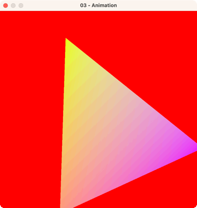
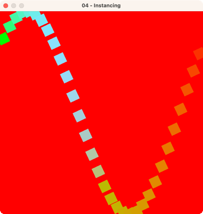
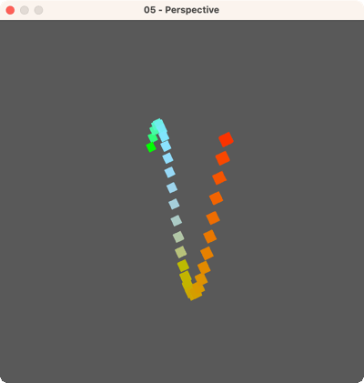
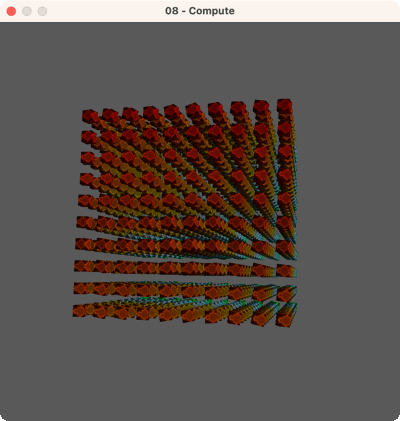
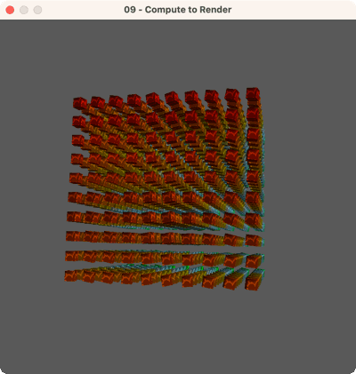

# metal-zig

Metal for Zig on macOS, using the **native** AppKit, Metal and MetalKit
Objective-C headers translated to Zig by `translate-c`. There's no metal-cpp
and no hand-written bindings. It's a library, `metal`, plus ports of Apple's
LearnMetalCPP samples that use it.

[`src/metal.m`](src/metal.m) imports the headers:

```objc
#import <objc/runtime.h>
#import <AppKit/AppKit.h>
#import <Metal/Metal.h>
#import <MetalKit/MetalKit.h>
```

and `build.zig` turns it into a Zig module with `b.addTranslateC`. Objective-C
classes and protocols become opaque Zig types whose methods send Objective-C
messages, and `obj.as(T)` casts to a superclass or protocol to reach inherited
methods:

```zig
const device = objc.MTLCreateSystemDefaultDevice() orelse return error.NoMetalDevice;
const queue = device.newCommandQueue().?;
const encoder = queue.commandBuffer().?.renderCommandEncoderWithDescriptor(pass).?;
encoder.drawPrimitives_vertexStart_vertexCount(objc.MTLPrimitiveTypeTriangle, 0, 3);
encoder.as(objc.MTLCommandEncoder).endEncoding();
```

## Installing Zig with Objective-C support

Upstream translate-c can't read Objective-C headers, so you need Zig 0.18
built from the `objc-import` branch of
[gaarutyunov/zig](https://github.com/gaarutyunov/zig). Zig vendors arocc and
translate-c, so that branch already contains the changes from the
`objc-import` branches of
[gaarutyunov/arocc](https://github.com/gaarutyunov/arocc) and
[gaarutyunov/translate-c](https://github.com/gaarutyunov/translate-c). Zig is
the only thing to build.

The quickest build needs only a C compiler and no LLVM:

```sh
git clone --branch objc-import https://github.com/gaarutyunov/zig.git
cd zig
cc -o bootstrap bootstrap.c
./bootstrap
./zig2 build -Denable-llvm=false -Dno-langref -Doptimize=ReleaseFast -p ~/.local/zig-objc
export PATH="$HOME/.local/zig-objc/bin:$PATH"
zig version
```

`./bootstrap` builds `zig2` (about 15 minutes), which then builds and installs
the compiler and its standard library into `~/.local/zig-objc` (a few
minutes). `-Dno-langref` skips the language reference, whose doc tests need
LLVM. Leave `-Doptimize=ReleaseFast` in, because a Debug build of the compiler
crashes. Add the `export` line to your shell profile to keep the fork on
`PATH`.

This build has no LLVM backend, so it lacks release-mode optimizations and
can't compile C or Objective-C sources. metal-zig needs neither. It has been
tested on an Intel Mac. On Apple Silicon, or to get optimized release builds,
build the fork with LLVM 23 instead (`brew install llvm lld`), following
"Building from Source" in the fork's README.

For editor support, build the `objc-import` branch of
[gaarutyunov/zls](https://github.com/gaarutyunov/zls) with this Zig.

## Using the library

Add the package to your project's `build.zig.zon`:

```sh
zig fetch --save git+https://github.com/gaarutyunov/metal-zig
```

Then import the `metal` module in `build.zig`. The module links the
frameworks it needs, so nothing else is required:

```zig
const std = @import("std");

pub fn build(b: *std.Build) void {
    const target = b.standardTargetOptions(.{});
    const optimize = b.standardOptimizeOption(.{});

    const metal = b.dependency("metal", .{ .target = target, .optimize = optimize });

    const exe = b.addExecutable(.{
        .name = "app",
        .root_module = b.createModule(.{
            .root_source_file = b.path("src/main.zig"),
            .target = target,
            .optimize = optimize,
            .imports = &.{
                .{ .name = "metal", .module = metal.module("metal") },
            },
        }),
    });
    b.installArtifact(exe);
}
```

A window that clears to red every frame:

```zig
const metal = @import("metal");
const objc = metal.objc;

const Renderer = struct {
    queue: *objc.MTLCommandQueue,

    pub fn init(device: *objc.MTLDevice) !Renderer {
        return .{ .queue = device.newCommandQueue() orelse return error.NoCommandQueue };
    }

    pub fn draw(r: *Renderer, view: *objc.MTKView) void {
        const cmd = r.queue.commandBuffer() orelse return;
        const encoder = cmd.renderCommandEncoderWithDescriptor(view.currentRenderPassDescriptor()) orelse return;
        encoder.as(objc.MTLCommandEncoder).endEncoding();
        if (view.currentDrawable()) |drawable| cmd.presentDrawable(drawable.as(objc.MTLDrawable));
        cmd.commit();
    }
};

pub fn main() !void {
    try metal.app.run(Renderer, .{ .title = "Hello Metal" });
}
```

What's in [`metal`](src/root.zig):

- `metal.objc`: the translated headers, with every class, protocol, function
  and constant of AppKit, Foundation, Metal, MetalKit and the Objective-C
  runtime.
- [`metal.app`](src/app.zig): `run(Renderer, options)` starts an AppKit
  application with a menu bar (Cmd-W, Cmd-Q, and an optional extra menu) and
  a window holding an `MTKView`. It calls `Renderer.init(device)` once,
  `draw(view)` every frame, and `deinit()` when the app quits, if the
  renderer has one. The options set the title, the clear color and the depth
  format. The delegate is an Objective-C class created at runtime with
  `objc_allocateClassPair`, with Zig functions as method implementations.
- Helpers ([`src/util.zig`](src/util.zig)):
  - strings: `nsString`, `zigString`, `release`;
  - shaders and pipelines: `newLibrary` compiles Metal source, plus
    `newFunction` and `newRenderPipeline`;
  - buffers: `newBuffer`, `newBufferWithData`, `contents`, `contentsSlice`,
    `didModify`;
  - `FrameSemaphore` limits the frames in flight. It passes
    `addCompletedHandler:` a block literal built by hand to the Clang block
    ABI, because translate-c exposes block types as opaque pointers.
- [`metal.math`](src/math.zig): `float2`, `float3`, `float4`, `float3x3` and
  `float4x4` with the memory layout of the Metal types, for structs shared
  with shaders, plus transforms: `perspective`, `rotateX`/`Y`/`Z`,
  `translate`, `scale`, `mul`. translate-c's `simd_float4x4` can't go in
  `extern struct`s, because its columns are Zig vectors.

`zig build test` runs the library's tests.

## Examples

The examples are ports of Apple's [metal-cpp](https://developer.apple.com/metal/cpp/)
"LearnMetalCPP" samples, one per sample, with the same shaders and the same
steps. Cmd-W closes the window and Cmd-Q quits.

### [00-window](examples/00-window/main.zig)

An AppKit window and menu bar with an `MTKView`, which clears to red every
frame. Everything the other ports build on, with nothing drawn yet.

```sh
zig build run-00-window
```


### [01-primitive](examples/01-primitive/main.zig)

A triangle with per-vertex colors: vertex buffers, a shader compiled from
source at runtime and a render pipeline.

```sh
zig build run-01-primitive
```


### [02-argbuffers](examples/02-argbuffers/main.zig)

The same triangle, with its vertex buffers passed to the shader through an
argument buffer encoded with `MTLArgumentEncoder`, and made resident with
`useResource`.

```sh
zig build run-02-argbuffers
```


### [03-animation](examples/03-animation/main.zig)

The triangle rotated by an angle that the CPU updates every frame. The
per-frame data lives in one buffer per frame in flight, and a semaphore,
signalled from the command buffer's completion handler, stops the CPU from
running more than three frames ahead of the GPU.

```sh
zig build run-03-animation
```



### [04-instancing](examples/04-instancing/main.zig)

A wave of quads drawn with one instanced, indexed draw call, with a transform
and a color per instance.

```sh
zig build run-04-instancing
```



### [05-perspective](examples/05-perspective/main.zig)

The quads become cubes rotating in 3D, with a perspective projection, a depth
buffer and back-face culling. The transforms come from the samples' tiny math
library.

```sh
zig build run-05-perspective
```



### [06-lighting](examples/06-lighting/main.zig)

A 10x10x10 grid of cubes with per-vertex normals, lit by a directional light
in the fragment shader.

```sh
zig build run-06-lighting
```


### [07-texturing](examples/07-texturing/main.zig)

The lit cubes with a checkerboard texture, made on the CPU and sampled in the
fragment shader.

```sh
zig build run-07-texturing
```


### [08-compute](examples/08-compute/main.zig)

The texture generated once on the GPU by a compute kernel that draws the
Mandelbrot set.

```sh
zig build run-08-compute
```



### [09-compute-to-render](examples/09-compute-to-render/main.zig)

The compute kernel run every frame, zooming into the Mandelbrot set, in the
same command buffer as the render pass that samples its texture.

```sh
zig build run-09-compute-to-render
```



### [10-frame-debugging](examples/10-frame-debugging/main.zig)

A programmatic GPU frame capture: a frame is captured to a `.gputrace` in the
temporary directory and opened in Xcode, from the Capture menu (Cmd-C) or
automatically after three seconds. Capturing is enabled with the
`METAL_CAPTURE_ENABLED` environment variable, because a plain executable has
no Info.plist to set `MetalCaptureEnabled` in.

```sh
zig build run-10-frame-debugging
```

## Media

`tools/record.sh` regenerates the media in `docs/`. The static windows are
captured with `screencapture -l <window id>`, and the animated ones are
recorded to GIFs by `tools/windowgif.swift`, using CoreGraphics and ImageIO.
It leaves out `10-frame-debugging`, which opens Xcode with its capture after
three seconds.

## License

[Apache License 2.0](LICENSE). The examples, and the app scaffolding and math
library in `src/`, are ports of Apple's LearnMetalCPP sample code, also
Apache 2.0. See [NOTICE](NOTICE).
