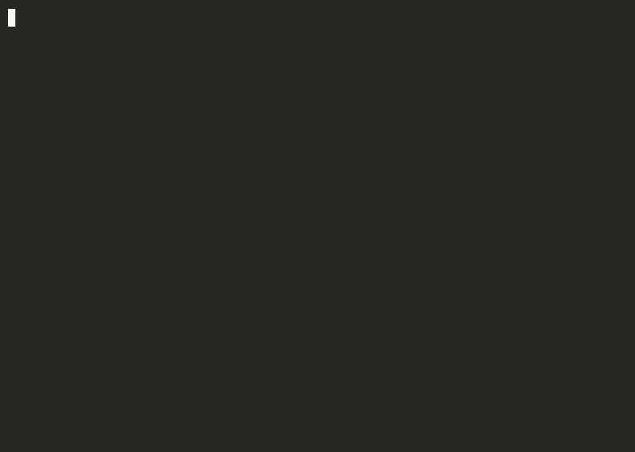
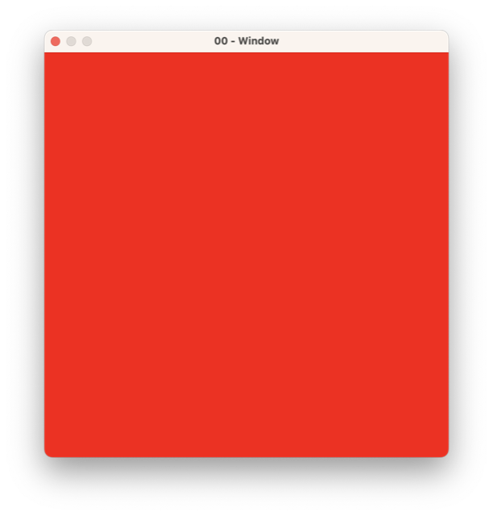
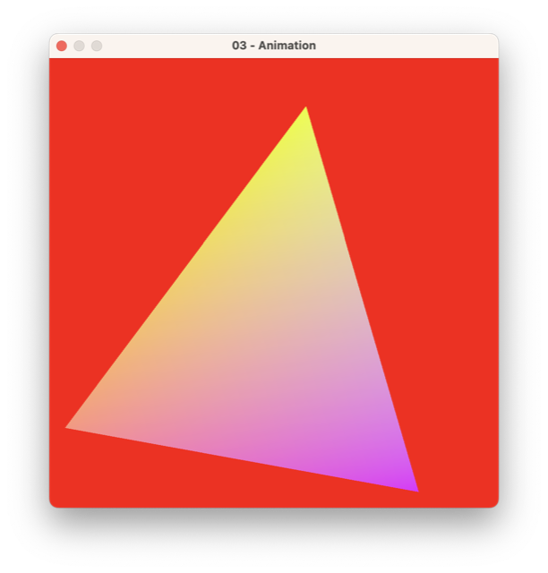
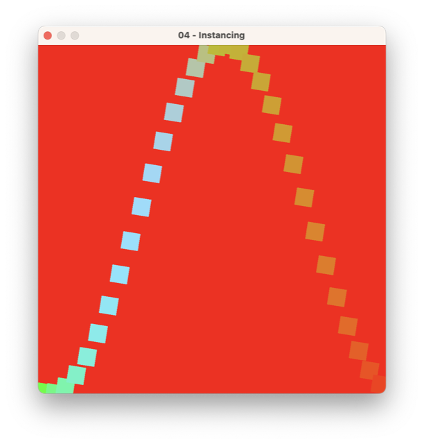
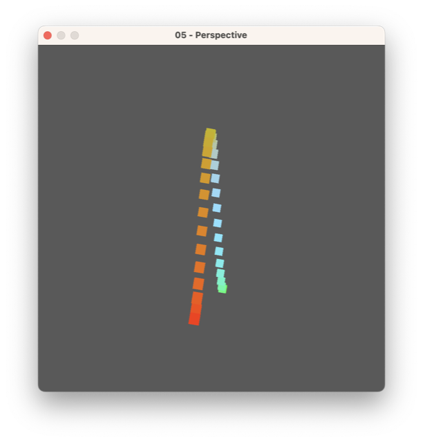
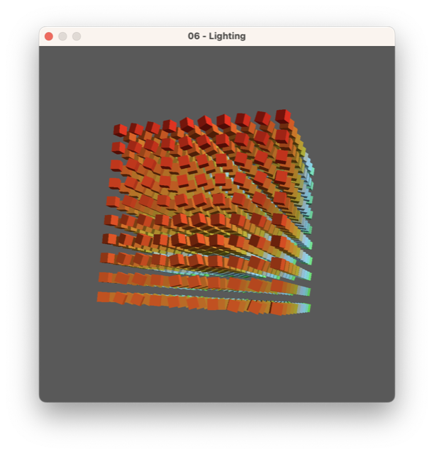
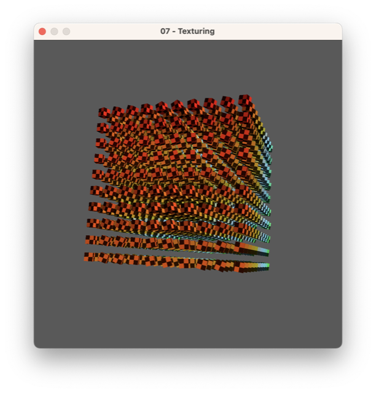
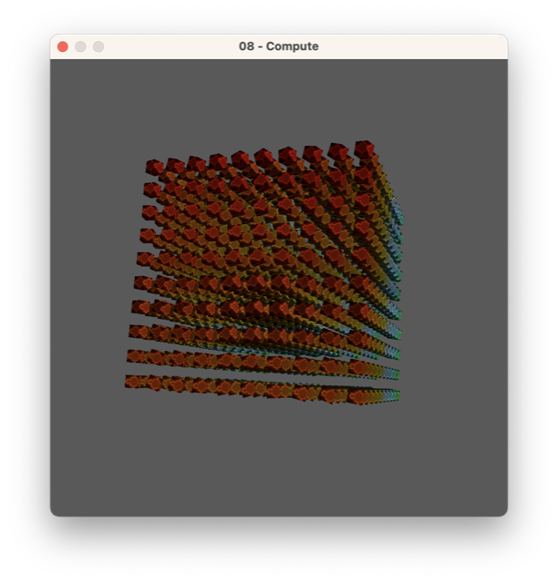
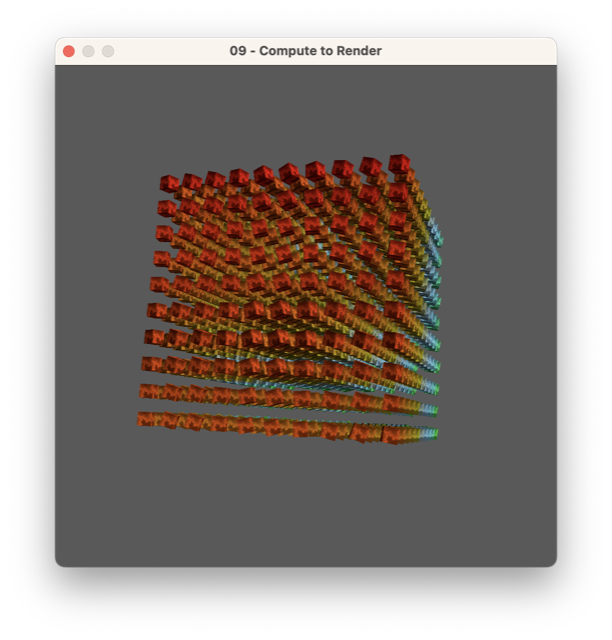

# metal-zig

Metal examples in Zig, using the **native** AppKit, Metal and MetalKit
Objective-C headers translated to Zig by `translate-c`. No metal-cpp, no
hand-written bindings.

`src/metal.m` imports the headers:

```objc
#import <objc/runtime.h>
#import <AppKit/AppKit.h>
#import <Metal/Metal.h>
#import <MetalKit/MetalKit.h>
```

and `build.zig` turns it into a Zig module with `b.addTranslateC`. Objective-C
classes and protocols become opaque Zig types whose methods send Objective-C
messages, and `obj.as(T)` casts to a superclass or protocol to reach inherited
methods:

```zig
const device = objc.MTLCreateSystemDefaultDevice() orelse return error.NoMetalDevice;
const queue = device.newCommandQueue().?;
const encoder = queue.commandBuffer().?.renderCommandEncoderWithDescriptor(pass).?;
encoder.drawPrimitives_vertexStart_vertexCount(objc.MTLPrimitiveTypeTriangle, 0, 3);
encoder.as(objc.MTLCommandEncoder).endEncoding();
```

## Examples

### 00-device

Lists the Metal GPU devices and their properties, and creates a MetalKit
`MTKTextureLoader` for the default device.

```sh
zig build run-00-device
```



### LearnMetalCPP ports

`00-window` to `10-frame-debugging` are ports of Apple's
[metal-cpp](https://developer.apple.com/metal/cpp/) "LearnMetalCPP" samples,
one per sample, with the same shaders and the same steps. Run them with
`zig build run-<name>`. Cmd-W closes the window and Cmd-Q quits.

| Example | What it adds |
| --- | --- |
| `00-window` | An AppKit window and menu bar with an `MTKView` that clears to red |
| `01-primitive` | A triangle with per-vertex colors, from vertex buffers and a shader compiled at runtime |
| `02-argbuffers` | The vertex buffers passed through an argument buffer, encoded with `MTLArgumentEncoder` |
| `03-animation` | A rotation angle updated every frame, with one buffer per frame in flight and a semaphore |
| `04-instancing` | A row of quads drawn with one instanced, indexed draw call |
| `05-perspective` | Cubes in 3D with a perspective projection, a depth buffer and back-face culling |
| `06-lighting` | A 10x10x10 grid of cubes with normals and a directional light |
| `07-texturing` | A checkerboard texture made on the CPU and sampled in the fragment shader |
| `08-compute` | The texture generated by a Mandelbrot compute kernel |
| `09-compute-to-render` | The compute kernel run every frame, zooming the texture, in the render's command buffer |
| `10-frame-debugging` | A programmatic GPU capture to a `.gputrace` (Capture menu, Cmd-C, or automatically after 3 s), opened in Xcode |

<p>










</p>

The examples share `examples/common`:

- `app.zig` is the AppKit scaffolding of the samples (`MyAppDelegate` and
  `MyMTKViewDelegate`): the menu bar, the window and the `MTKView`. Each
  example only provides a `Renderer` with `init`, `draw` and `deinit`. The
  delegate is an Objective-C class created at runtime with
  `objc_allocateClassPair`, using Zig functions as method implementations.
- `util.zig` has helpers for strings, shaders, pipelines and buffers.
  `FrameSemaphore` limits the frames in flight. It passes
  `addCompletedHandler:` a block literal built by hand to the Clang block
  ABI, because translate-c exposes block types as opaque pointers.
- `math.zig` is the samples' tiny math library. Its `float3`, `float4x4`
  and other types have the memory layout of the Metal types. translate-c's
  `simd_float4x4` cannot go in `extern struct`s, because its columns are Zig
  vectors.

`10-frame-debugging` enables capturing with the `METAL_CAPTURE_ENABLED`
environment variable, because a plain executable has no Info.plist to set
`MetalCaptureEnabled` in.

`zig build test` runs the math tests.

## Requirements

A Zig 0.18 build with Objective-C support in translate-c, from the
`objc-import` branches of:

- https://github.com/gaarutyunov/zig
- https://github.com/gaarutyunov/arocc
- https://github.com/gaarutyunov/translate-c
- https://github.com/gaarutyunov/zls (editor support)

## Media

`tools/record.sh` regenerates the media in `docs/`: the terminal recording is
made with [asciinema](https://asciinema.org) and rendered to a GIF with
[agg](https://github.com/asciinema/agg), and the windows are captured with
`screencapture -l <window id>`. It leaves out `10-frame-debugging`, which
opens Xcode with its capture after three seconds.
