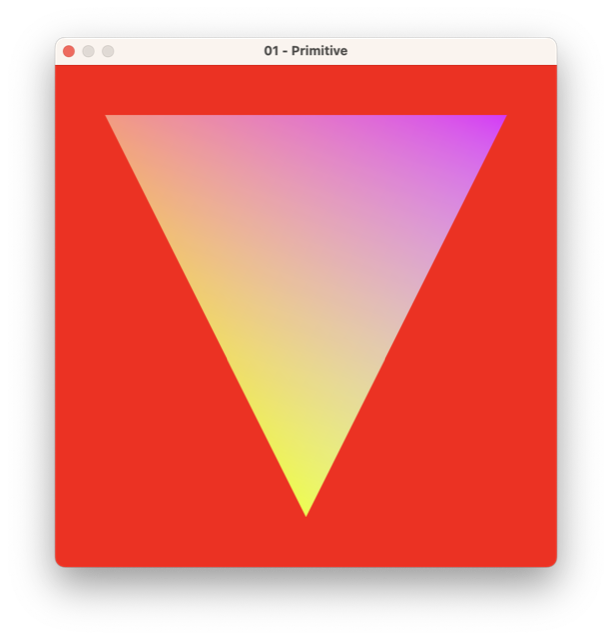
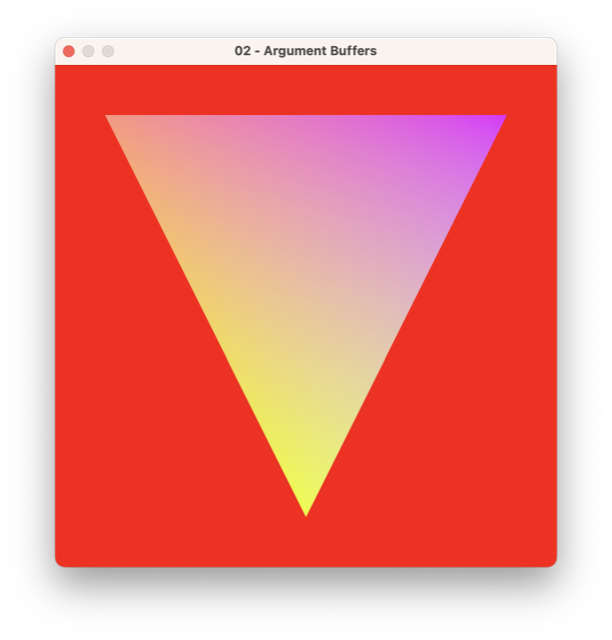
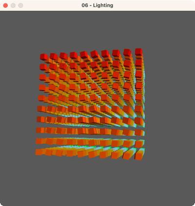
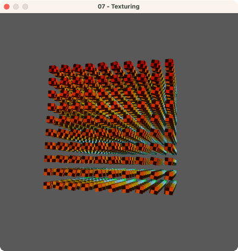

# metal-zig

Metal examples in Zig, using the **native** AppKit, Metal and MetalKit
Objective-C headers translated to Zig by `translate-c`. No metal-cpp, no
hand-written bindings.

`src/metal.m` imports the headers:

```objc
#import <objc/runtime.h>
#import <AppKit/AppKit.h>
#import <Metal/Metal.h>
#import <MetalKit/MetalKit.h>
```

and `build.zig` turns it into a Zig module with `b.addTranslateC`. Objective-C
classes and protocols become opaque Zig types whose methods send Objective-C
messages, and `obj.as(T)` casts to a superclass or protocol to reach inherited
methods:

```zig
const device = objc.MTLCreateSystemDefaultDevice() orelse return error.NoMetalDevice;
const queue = device.newCommandQueue().?;
const encoder = queue.commandBuffer().?.renderCommandEncoderWithDescriptor(pass).?;
encoder.drawPrimitives_vertexStart_vertexCount(objc.MTLPrimitiveTypeTriangle, 0, 3);
encoder.as(objc.MTLCommandEncoder).endEncoding();
```

## Examples

The examples are ports of Apple's [metal-cpp](https://developer.apple.com/metal/cpp/)
"LearnMetalCPP" samples, one per sample, with the same shaders and the same
steps. Cmd-W closes the window and Cmd-Q quits.

### [00-window](examples/00-window/main.zig)

An AppKit window and menu bar with an `MTKView`, which clears to red every
frame. Everything the other ports build on, with nothing drawn yet.

```sh
zig build run-00-window
```


### [01-primitive](examples/01-primitive/main.zig)

A triangle with per-vertex colors: vertex buffers, a shader compiled from
source at runtime and a render pipeline.

```sh
zig build run-01-primitive
```



### [02-argbuffers](examples/02-argbuffers/main.zig)

The same triangle, with its vertex buffers passed to the shader through an
argument buffer encoded with `MTLArgumentEncoder`, and made resident with
`useResource`.

```sh
zig build run-02-argbuffers
```



### [03-animation](examples/03-animation/main.zig)

The triangle rotated by an angle that the CPU updates every frame. The
per-frame data lives in one buffer per frame in flight, and a semaphore,
signalled from the command buffer's completion handler, stops the CPU from
running more than three frames ahead of the GPU.

```sh
zig build run-03-animation
```


### [04-instancing](examples/04-instancing/main.zig)

A wave of quads drawn with one instanced, indexed draw call, with a transform
and a color per instance.

```sh
zig build run-04-instancing
```


### [05-perspective](examples/05-perspective/main.zig)

The quads become cubes rotating in 3D, with a perspective projection, a depth
buffer and back-face culling. The transforms come from the samples' tiny math
library.

```sh
zig build run-05-perspective
```


### [06-lighting](examples/06-lighting/main.zig)

A 10x10x10 grid of cubes with per-vertex normals, lit by a directional light
in the fragment shader.

```sh
zig build run-06-lighting
```



### [07-texturing](examples/07-texturing/main.zig)

The lit cubes with a checkerboard texture, made on the CPU and sampled in the
fragment shader.

```sh
zig build run-07-texturing
```



### [08-compute](examples/08-compute/main.zig)

The texture generated once on the GPU by a compute kernel that draws the
Mandelbrot set.

```sh
zig build run-08-compute
```


### [09-compute-to-render](examples/09-compute-to-render/main.zig)

The compute kernel run every frame, zooming into the Mandelbrot set, in the
same command buffer as the render pass that samples its texture.

```sh
zig build run-09-compute-to-render
```


### [10-frame-debugging](examples/10-frame-debugging/main.zig)

A programmatic GPU frame capture: a frame is captured to a `.gputrace` in the
temporary directory and opened in Xcode, from the Capture menu (Cmd-C) or
automatically after three seconds. Capturing is enabled with the
`METAL_CAPTURE_ENABLED` environment variable, because a plain executable has
no Info.plist to set `MetalCaptureEnabled` in.

```sh
zig build run-10-frame-debugging
```

### [Shared code](examples/common)

The ports share `examples/common`:

- [`app.zig`](examples/common/app.zig) is the AppKit scaffolding of the
  samples (`MyAppDelegate` and `MyMTKViewDelegate`): the menu bar, the window
  and the `MTKView`. Each example only provides a `Renderer` with `init`,
  `draw` and `deinit`. The delegate is an Objective-C class created at
  runtime with `objc_allocateClassPair`, using Zig functions as method
  implementations.
- [`util.zig`](examples/common/util.zig) has helpers for strings, shaders,
  pipelines and buffers. `FrameSemaphore` limits the frames in flight. It
  passes `addCompletedHandler:` a block literal built by hand to the Clang
  block ABI, because translate-c exposes block types as opaque pointers.
- [`math.zig`](examples/common/math.zig) is the samples' tiny math library.
  Its `float3`, `float4x4` and other types have the memory layout of the
  Metal types. translate-c's `simd_float4x4` cannot go in `extern struct`s,
  because its columns are Zig vectors.

`zig build test` runs the math tests.

## Requirements

A Zig 0.18 build with Objective-C support in translate-c, from the
`objc-import` branches of:

- https://github.com/gaarutyunov/zig
- https://github.com/gaarutyunov/arocc
- https://github.com/gaarutyunov/translate-c
- https://github.com/gaarutyunov/zls (editor support)

## Media

`tools/record.sh` regenerates the media in `docs/`. The static windows are
captured with `screencapture -l <window id>`, and the animated ones are
recorded to GIFs by `tools/windowgif.swift`, using CoreGraphics and ImageIO.
It leaves out `10-frame-debugging`, which opens Xcode with its capture after
three seconds.
