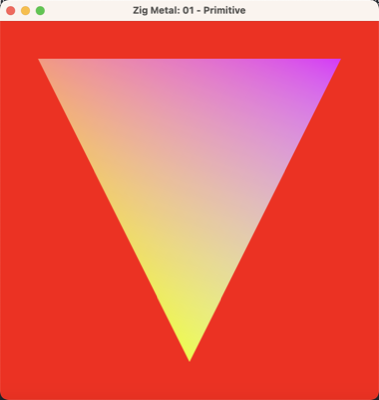

# zig-metal-device

The classic Metal "hello triangle" in Zig: a window with an `MTKView` drawing a
gradient triangle, modelled on the
[metal-cpp](https://developer.apple.com/metal/cpp/) `01-primitive` sample, but
**without metal-cpp**. The native AppKit, Metal and MetalKit Objective-C
headers are translated to Zig by `translate-c`.



`src/metal.m` imports the headers:

```objc
#import <objc/runtime.h>
#import <AppKit/AppKit.h>
#import <Metal/Metal.h>
#import <MetalKit/MetalKit.h>
```

and `build.zig` turns it into a Zig module with `b.addTranslateC`. Objective-C
classes and protocols become opaque Zig types whose methods send Objective-C
messages:

```zig
const cmd = queue.commandBuffer() orelse return;
const encoder = cmd.renderCommandEncoderWithDescriptor(view.currentRenderPassDescriptor()) orelse return;
encoder.setRenderPipelineState(pipeline);
encoder.drawPrimitives_vertexStart_vertexCount(objc.MTLPrimitiveTypeTriangle, 0, 3);
encoder.as(objc.MTLCommandEncoder).endEncoding();
```

`obj.as(T)` casts to a superclass or protocol to reach inherited methods. The
application and `MTKView` delegates are Objective-C classes created at runtime
with `objc_allocateClassPair`, using Zig functions as method implementations.

## Requirements

A Zig 0.18 build with Objective-C support in translate-c, from the
`objc-import` branches of:

- https://github.com/gaarutyunov/zig
- https://github.com/gaarutyunov/arocc
- https://github.com/gaarutyunov/translate-c
- https://github.com/gaarutyunov/zls (editor support)

## Usage

```sh
zig build run
```

Cmd-W closes the window and Cmd-Q quits.
